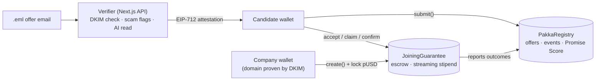

# Pakka

**Is your offer *pakka*?** Pakka lets job seekers check that an offer letter really came from the company, shows which employers keep their joining dates, and pays candidates while they wait when an employer doesn't.

Built for ChainShift 2026 (Hack4Hack). It runs on the Base Sepolia testnet; all money in the demo is test money.

## The problem

An offer letter is a promise with no teeth.

- Infosys, Wipro and TCS postponed joining for 10,000+ freshers ([Outlook Business](https://www.outlookbusiness.com/corporate/it-giants-infosys-wipro-tcs-postpone-onboarding-of-over-10000-graduates)). Tech Mahindra left 1,000+ graduates from its 2025 campus batch waiting, some with no formal offer letter for nearly a year ([People Matters](https://www.peoplematters.in/news/strategic-hr/tech-mahindra-delays-onboarding-of-1000-freshers-amid-hiring-slowdown-48782)).
- Fake offers copy real company branding and ask for "refundable deposits". In a 2026 Indeed survey, 46% of job seekers who met fraudulent offers said they lost money ([Business Today](https://www.businesstoday.in/jobs/story/more-than-9-in-10-job-seekers-encounter-fake-job-offers-542006-2026-07-09)).
- When a company delays or revokes an offer, nothing happens to it. The candidate has already turned down other offers.

## What Pakka does

| | For candidates | How it works |
|---|---|---|
| **Verify** | Drop in the original offer email (.eml). In seconds you know whether it's genuine, edited, or a scam. | Every company mail server signs its outgoing email with **DKIM**. Pakka checks the signature against the company's DNS key, requires it to match the From domain and cover the whole body, and flags free mailboxes, lookalike domains (`tcs-onboarding.com`), fee requests, WhatsApp-only contact and pressure tactics. An optional AI read (NEAR AI) extracts the role, pay and joining date. |
| **Record** | Record your verified offer, and later any postponement or revocation email. | The verifier signs an **EIP-712 attestation** that the candidate submits to `PakkaRegistry`. Only a hash, the company domain and dates go onchain, never the letter. Each email can be used once. If a company goes silent, the candidate can report a delay once the joining date plus 7 days has passed. |
| **Promise Score** | See which companies keep their word before you accept. | Built only from verified emails and escrowed offers, never anonymous reviews. On time = 1 point, late or delayed = 0.5, revoked = 0. Nobody, including us, can edit it. |
| **Guarantee** | Get offers with money behind them. | A company proves its domain with a DKIM-signed email (`Pakka verify 0x…`), then locks a **joining guarantee** in stablecoins in `JoiningGuarantee`. If joining slips past the promised date plus grace, a **stipend streams to the candidate every second**; postponing doesn't pause it. If the company revokes, the candidate gets everything left. Join on time and the company gets it all back. |

| **Share** | Prove your offer to family, a bank or a college without sending the letter. | Every recorded offer gets a public page (`/offer/<id>`) with a link-preview image for LinkedIn and WhatsApp. Companies get a live **Promise Score badge** (`/api/badge/<domain>`) to embed on their careers page. |

Candidates get value on day one, before any employer signs up: verification and the Promise Score need nothing from the company. The guarantee is the premium tier employers opt into.

## Demo video

[`docs/pakka-demo.mp4`](docs/pakka-demo.mp4) is a 2:50 captioned walkthrough recorded against the live Base Sepolia contracts. Re-record it with `node apps/web/e2e/record-demo.cjs http://localhost:3000`.

## Try it

Run the app (see below) or open the deployed demo, then:

1. On the home page, click **Lookalike scam**, **Salary edited** and **Genuine offer** to see the three verdicts.
2. Record the genuine offer with an **instant guest wallet** (no extension, free test gas).
3. Switch the header role to **Company**, open **Employers**, click **Use demo company Nimbus Systems**, and link the wallet.
4. Make a guaranteed offer to the **Demo candidate**.
5. Switch back to **Candidate**, accept, then press **+1 month** in the demo time machine and watch the stipend stream.
6. Switch to **Company** and revoke: the candidate is paid out and the Promise Score drops.

The demo companies (`nimbus.demo`, `orbit.demo`, `tcs-onboarding.demo`) are fictional. The `.demo` TLD doesn't exist, so their signing key can never vouch for a real domain. Real emails are checked against the real DNS.

## Deployed contracts (Base Sepolia)

| Contract | Address |
|---|---|
| PakkaRegistry | [`0x5c83d1257624cb1cf85d2820d68a3408bb5e3caf`](https://sepolia.basescan.org/address/0x5c83d1257624cb1cf85d2820d68a3408bb5e3caf) |
| JoiningGuarantee (demo mode) | [`0x7fabf0ab3f26d476cd22c3736d02198b94551012`](https://sepolia.basescan.org/address/0x7fabf0ab3f26d476cd22c3736d02198b94551012) |
| TestUSD (pUSD, open faucet) | [`0x13423e285d2fafde534afedfce20fc188745f4a1`](https://sepolia.basescan.org/address/0x13423e285d2fafde534afedfce20fc188745f4a1) |

## Architecture



```
packages/verifier   DKIM verification, offer extraction, red flags, AI read, attestation signing, demo emails
packages/contracts  PakkaRegistry, JoiningGuarantee, TestUSD (Hardhat, Solidity 0.8.28)
apps/web            Next.js app and API routes (/api/verify, /api/attest, /api/demo-email, /api/gas, /api/badge)
```

### Trust model

- **DKIM proves who sent an email and that it wasn't edited.** It doesn't prove the company is legitimate, so the app says exactly that, and adds the scam heuristics on top.
- **The verifier is trusted to run the DKIM check honestly.** It holds one signing key, which the registry owner can rotate (`setVerifier`). The roadmap replaces it with **zkEmail** proofs, so the contract checks the DKIM signature itself and nobody has to be trusted.
- **Old emails:** companies rotate DKIM keys, so very old emails may no longer verify against current DNS. The roadmap adds an archive of historical keys.
- **Joining disputes:** a company's claim that a candidate joined settles after 7 days unless the candidate disputes it; disputes go to an arbiter (the contract owner on the demo). Paid stipend is never clawed back.
- **Demo mode** lets either party fast-forward one offer's clock. A production deployment sets `DEMO_MODE=false`, which disables it.

## Run it locally

Requires Node 22+ and pnpm 10.

```bash
pnpm install
```

```bash
pnpm --filter @pakka/contracts exec hardhat node
```

In a second terminal:

```bash
pnpm --filter @pakka/contracts exec hardhat run scripts/deploy.ts --network localhost
```

```bash
cd apps/web && node scripts/use-deployment.mjs localhost && pnpm dev
```

Open http://localhost:3000. Locally the verifier and gas-drip keys default to Hardhat's dev accounts.

To use the Base Sepolia deployment instead, skip the chain and deploy steps: `apps/web/.env.production` already points at it, so `pnpm build && pnpm start` uses it. Set the server variables below first.

### Server environment variables

| Variable | Purpose |
|---|---|
| `VERIFIER_PRIVATE_KEY` | Signs attestations. Must match the registry's `verifier`. |
| `FAUCET_PRIVATE_KEY` | Funds the gas drip that gives guest wallets test ETH. |
| `NEARAI_API_KEY` | Optional AI read of emails (NEAR AI Cloud). Set `PAKKA_AI=off` to disable. |
| `NEXT_PUBLIC_SITE_URL` | Optional public URL for link previews; on Vercel the production URL is used automatically. |
| `NEXT_PUBLIC_RPC_URL` | Optional dedicated RPC; public Base Sepolia endpoints are used with fallbacks otherwise. |

### Deploy the web app (Vercel)

Import the repository, set the root directory to `apps/web`, add the server variables above, and deploy. The build picks up the contract addresses from `apps/web/.env.production`.

### Deploy new contracts

```bash
cd packages/contracts && pnpm exec hardhat compile
```

```bash
DEPLOYER_PRIVATE_KEY=0x... VERIFIER_ADDRESS=0x... npx ts-node scripts/deploy-viem.ts baseSepolia
```

```bash
cd ../../apps/web && node scripts/use-deployment.mjs baseSepolia .env.production
```

## Tests

```bash
pnpm test:verifier
```

```bash
pnpm test:contracts
```

```bash
cd apps/web && node e2e/demo-flow.cjs http://localhost:3000
```

- **Verifier (20 tests):** genuine, tampered, unsigned and lookalike-scam emails; signatures from another domain; free mailboxes; replay protection; date parsing; lookalike detection without false positives; EIP-712 signing; DNS-over-HTTPS parsing; AI failure handling.
- **Contracts (18 tests):** attestation checks (signer, expiry, subject, replay), company verification, postponement / revocation / joining accounting and the Promise Score, silent-delay reporting, and every guarantee path (cancel, streaming stipend through a postponement, revoke payout, on-time and late joining, join claims and disputes, candidate withdrawal, demo mode off).
- **End to end:** drives the whole two-sided demo in a real browser, as candidate and company, including the shareable proof page, its preview image and the badge, and checks the phone layout. It passes against both a local chain and Base Sepolia.

## Roadmap

1. zkEmail proofs so the DKIM check runs onchain with no trusted verifier.
2. An archive of historical DKIM keys, so older offer emails still verify.
3. Placement-cell pilots: a college requires escrowed offers from companies recruiting on campus.
4. UPI off-ramp for stipend payouts through a licensed partner.
5. Real USDC and a dispute process run by a neutral panel.
